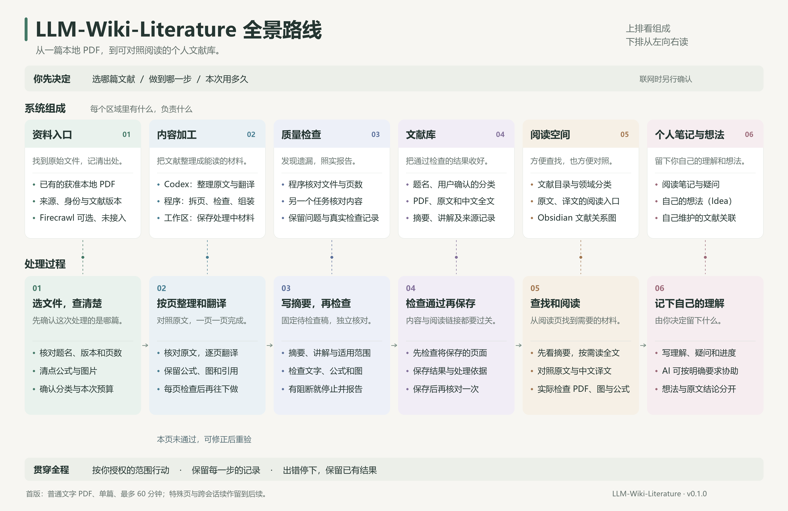

# LLM-Wiki-Literature 全景路线

- [可放大的 SVG](literature-panorama.svg)
- [PNG 原图](literature-panorama.png)

## 怎么看

- 上排讲组成：资料入口、内容加工、质量检查、文献库、阅读空间和个人记录。
- 下排讲过程：沿箭头从左到右看一篇文献如何处理并保存。
- 上下相同颜色表示同一区域，竖向虚线表示对应关系。
- 检查发现问题时先报告与停止；未冻结的候选可在原预算内修正并重验。
- 冻结后、到期后或更换聊天不能借图中的回转线接续旧 run。
- 用户笔记和想法由自己维护，AI 不自动确认文献关系或科学结论。

首版范围与实际状态见 [USER_GUIDE.md](../USER_GUIDE.md) 和
[RELEASE_NOTES.md](RELEASE_NOTES.md)。
图展示用途与顺序，不授予联网、读取、预算或保存权限。

## 可编辑资源

- `panorama-content.json` 保存通用文案。
- SVG 保留可编辑的文本与形状；不包含个人路径、文献数据或任务标识。
- 图沿用横向、上下对应的形式；PNG 与 SVG 使用相同文案。
